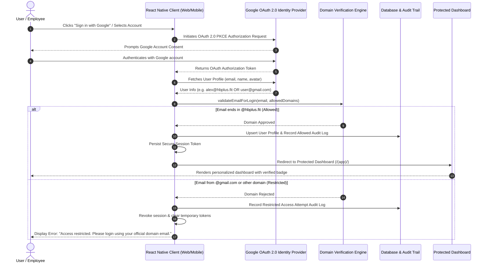

# Cross-Platform React Native App with Domain-Restricted Google Authentication

A production-ready cross-platform application built with **React Native (React Native for Web)** and **Expo Router** that supports **Web (Browser)**, **iOS**, and **Android** from a single unified codebase.

The application implements **Google OAuth 2.0** authentication and strictly enforces **enterprise email domain restriction** (allowing exclusively `@hbplus.fit` accounts and rejecting unauthorized domains like `@gmail.com`).

---

## 🚀 Live Demo & Key Highlights

- **Universal Cross-Platform**: Runs seamlessly in modern desktop/mobile web browsers and native mobile emulators/devices.
- **Strict Domain Validation**: Verifies the user's email domain post-OAuth; grants access only if the domain matches `@hbplus.fit`.
- **Immediate Error Handling**: Displays `"Access restricted. Please login using your official domain email."` when non-whitelisted domains attempt sign-in.
- **Route Protection**: Fully protected routes (`/(app)/`, `/(app)/admin`) preventing URL-tampering or direct unauthorized URL access on web.
- **Role-Based Access Control (RBAC)**: Supports `Admin` and `User` roles with distinct permissions, an Admin Console, allowed domain rule management, and a user directory.
- **Persistent Database & Audit Trail**: Real-time logging of authentication decisions (allowed vs restricted), tracking timestamp, email, platform, and reason.
- **1-Click Testing Suite**: Built-in test harness on the login screen for instant verification of both authorized and rejected scenarios without requiring custom Google Cloud keys during initial review.

---

## 🛠️ Tech Stack

| Layer | Technologies |
|---|---|
| **Framework** | React Native, Expo SDK 57, React Native for Web |
| **Routing** | Expo Router (File-based navigation & universal deep links) |
| **Authentication** | Google OAuth 2.0 (PKCE authorization flow, `expo-auth-session`) |
| **Database & Auth Backend** | Supabase (`@supabase/supabase-js`) & Cross-Platform Persistent Secure Store (`expo-secure-store` / `localStorage`) |
| **Language** | TypeScript (Strict type checking) |
| **Icons & UI** | `@expo/vector-icons`, responsive flexbox layout |

---

## 🔐 Authentication Flow



---

## 🛡️ How Domain Restriction Works

The core domain restriction engine resides in [`src/utils/domainValidator.ts`](file:///c:/Users/tanis/OneDrive/Desktop/cross_platform/src/utils/domainValidator.ts) and is invoked immediately upon receiving the authenticated user profile from Google.

### 1. Verification Algorithm
1. **Sanitization**: Trims whitespace and normalizes email casing to lowercase (`User@HBPLUS.FIT` $\rightarrow$ `user@hbplus.fit`).
2. **RFC Validation**: Validates standard email address RFC structure via regular expression.
3. **Domain Extraction**: Isolates the domain component following the final `@` symbol.
4. **Whitelist Comparison**: Matches extracted domain against configured active enterprise domains (`['hbplus.fit']` by default). Subdomains (such as `corp.hbplus.fit`) are also supported.
5. **Access Decision**:
   - **Match**: Session initialized, user registered in persistent store, access granted.
   - **Mismatch**: Session blocked, audit log created, standard rejection message returned:
     ```
     "Access restricted. Please login using your official domain email."
     ```

### 2. Test Scenarios Table

| Email Input | Domain | Validation Result | Outcome |
|---|---|---|---|
| `example@hbplus.fit` | `hbplus.fit` | ✅ **APPROVED** | Logged in $\rightarrow$ Redirected to Dashboard |
| `admin@hbplus.fit` | `hbplus.fit` | ✅ **APPROVED** | Logged in $\rightarrow$ Admin Privileges Granted |
| `example@gmail.com` | `gmail.com` | ❌ **DENIED** | Shows exact error: *"Access restricted. Please login using your official domain email."* |
| `candidate@yahoo.com`| `yahoo.com` | ❌ **DENIED** | Shows exact error: *"Access restricted. Please login using your official domain email."* |
| `invalid-string` | None | ❌ **DENIED** | Shows error: *"Invalid email address format."* |

---

## 🔒 Route Protection & Security Architecture

1. **Client-Side Guard (`(app)/_layout.tsx`)**:
   - Every route under the `(app)` group is guarded by active session validation.
   - If an unauthenticated user enters `http://localhost:8081/(app)` or attempts direct URL navigation, the layout component immediately intercepts the request and issues `<Redirect href="/(auth)/login" />`.
2. **Reverse Guard (`(auth)/_layout.tsx`)**:
   - Prevents already-authenticated users from revisiting the login page without signing out; redirects them to `/(app)/`.
3. **Hardware & Web Storage Isolation**:
   - On native platforms (iOS/Android), sensitive session tokens are stored in hardware-backed keychain storage via `expo-secure-store`.
   - On Web, storage uses scoped `localStorage` with fallback handling.
4. **Security Audit Log**:
   - Every login attempt (both approved and unauthorized attempts) generates an immutable audit record containing timestamp, email, status (`allowed` / `restricted`), platform (`web` / `ios` / `android`), and reason.

---

## 📁 Clean Folder Structure

```
cross_platform/
├── assets/                     # App icons, splash screens, adaptive icons
├── scripts/
│   └── test-validation.ts      # Automated unit test suite for domain verification
├── src/
│   ├── app/                    # Expo Router route definitions (File-based navigation)
│   │   ├── _layout.tsx         # Root layout with SafeAreaProvider & AuthProvider
│   │   ├── index.tsx           # Root redirector based on authentication state
│   │   ├── +not-found.tsx      # 404 page handler
│   │   ├── (auth)/             # Public unauthenticated routes
│   │   │   ├── _layout.tsx     # Auth stack layout with session check
│   │   │   └── login.tsx       # Login page with Google OAuth & Domain Test Suite
│   │   └── (app)/              # Protected authenticated routes
│   │       ├── _layout.tsx     # Protected layout (redirects unauthenticated users)
│   │       ├── index.tsx       # Protected Dashboard page
│   │       └── admin.tsx       # Protected Admin Console & Role-Based Access page
│   ├── components/
│   │   ├── ui/                 # Reusable atomic UI components
│   │   │   ├── GoogleSignInButton.tsx
│   │   │   ├── AlertBanner.tsx
│   │   │   ├── Card.tsx
│   │   │   ├── Badge.tsx
│   │   │   ├── Button.tsx
│   │   │   ├── Header.tsx
│   │   │   └── DomainTestHarness.tsx
│   │   ├── dashboard/          # Dashboard widgets
│   │   │   ├── StatsOverview.tsx
│   │   │   ├── RecentActivity.tsx
│   │   │   └── QuickActions.tsx
│   │   └── admin/              # Admin governance widgets
│   │       ├── DomainPolicyManager.tsx
│   │       ├── UserManagementTable.tsx
│   │       └── SecurityAuditLog.tsx
│   ├── context/
│   │   └── AuthContext.tsx     # Global authentication, session state, and RBAC
│   ├── hooks/
│   │   ├── useAuth.ts          # Authentication hook
│   │   ├── useResponsive.ts    # Screen size & breakpoint detection hook
│   │   └── useStorageState.ts  # Cross-platform secure storage hook
│   ├── services/
│   │   ├── authService.ts      # Google OAuth request flow, userinfo, simulation
│   │   ├── databaseService.ts  # Persistent storage for users, domains, audit logs
│   │   └── supabase.ts         # Supabase client configuration
│   ├── types/
│   │   └── index.ts            # TypeScript interfaces
│   └── utils/
│       ├── constants.ts        # Configuration defaults and error messages
│       └── domainValidator.ts  # Pure domain validation & normalization logic
├── app.json                    # Expo project configuration
├── package.json                # Project dependencies and npm scripts
├── tsconfig.json               # TypeScript configuration
└── README.md                   # Complete documentation
```

---

## ⚡ Setup & Run Instructions

### Prerequisites
- **Node.js**: v18.0.0 or later (Tested with Node v24)
- **npm** or **bun**

### 1. Install Dependencies
```bash
npm install
```

### 2. Run on Web (Browser)
```bash
npm run web
```
The application will start Metro bundler and launch at `http://localhost:8081` in your browser.

### 3. Run on Mobile (Android / iOS)
```bash
# Android emulator or connected device
npm run android

# iOS simulator (macOS required)
npm run ios

# Or start the universal Expo developer menu
npm start
```

### 4. Run Automated Validation Tests
Run the automated test runner to test all domain restriction scenarios:
```bash
npm test
```
**Expected Output:**
```
--- RUNNING DOMAIN RESTRICTION VALIDATION TESTS ---
✅ PASS: Accepts example@hbplus.fit
✅ PASS: Extracts domain hbplus.fit correctly
✅ PASS: Accepts uppercase Sarah.Connor@HBPLUS.FIT
✅ PASS: Rejects example@gmail.com
✅ PASS: Returns exact error message: "Access restricted. Please login using your official domain email."
✅ PASS: Rejects user@yahoo.com
✅ PASS: Returns standard restriction error for Yahoo
✅ PASS: Rejects non-email string
✅ PASS: Identifies invalid email format
✅ PASS: Accepts subdomain dev.hbplus.fit
✅ PASS: extractDomain normalizes lowercase
✅ PASS: extractDomain handles empty string

Results: 12/12 tests passed!
```

---

## 🧪 Evaluation & Demo Testing Guide

When testing the application in the browser or on a device, you can test both live Google OAuth and 1-click test presets:

1. **Testing Rejected Domain (`@gmail.com`)**:
   - In the Login page's **Domain Verification Test Suite**, click **"Restricted Gmail (example@gmail.com)"**.
   - **Result**: Access is immediately blocked and the high-contrast alert displays:
     > **"Access restricted. Please login using your official domain email."**
   - A security audit entry is logged under restricted attempts.

2. **Testing Authorized Domain (`@hbplus.fit`)**:
   - Click **"Authorized Staff (alex.rivera@hbplus.fit)"**.
   - **Result**: The session is approved, stored securely, and automatically redirected to the **Protected Dashboard**.
   - The user is greeted with a verified badge `@hbplus.fit` and role `Authorized Member`.

3. **Testing Role-Based Access (Admin Console)**:
   - Click **"Security Admin (admin@hbplus.fit)"** on login, or use the **"Demo Role Switcher"** inside the app.
   - Access the **Admin Console** tab to:
     - Add or remove custom allowed domain rules (e.g., `partners.hbplus.fit`).
     - View the directory of all registered database users and toggle roles between Admin and Member.
     - Inspect the live **Real-time Security Audit Trail** showing all allowed and blocked login attempts with timestamps and platform details.

4. **Testing Route Protection**:
   - Open a new incognito window or log out.
   - Try navigating directly to `http://localhost:8081/(app)` or `http://localhost:8081/(app)/admin`.
   - **Result**: You are automatically bounced back to `/(auth)/login`. Direct URL tampering is prevented.

---

## 📄 License
MIT License. Created for the Cross-Platform Mobile & Web Assessment.
